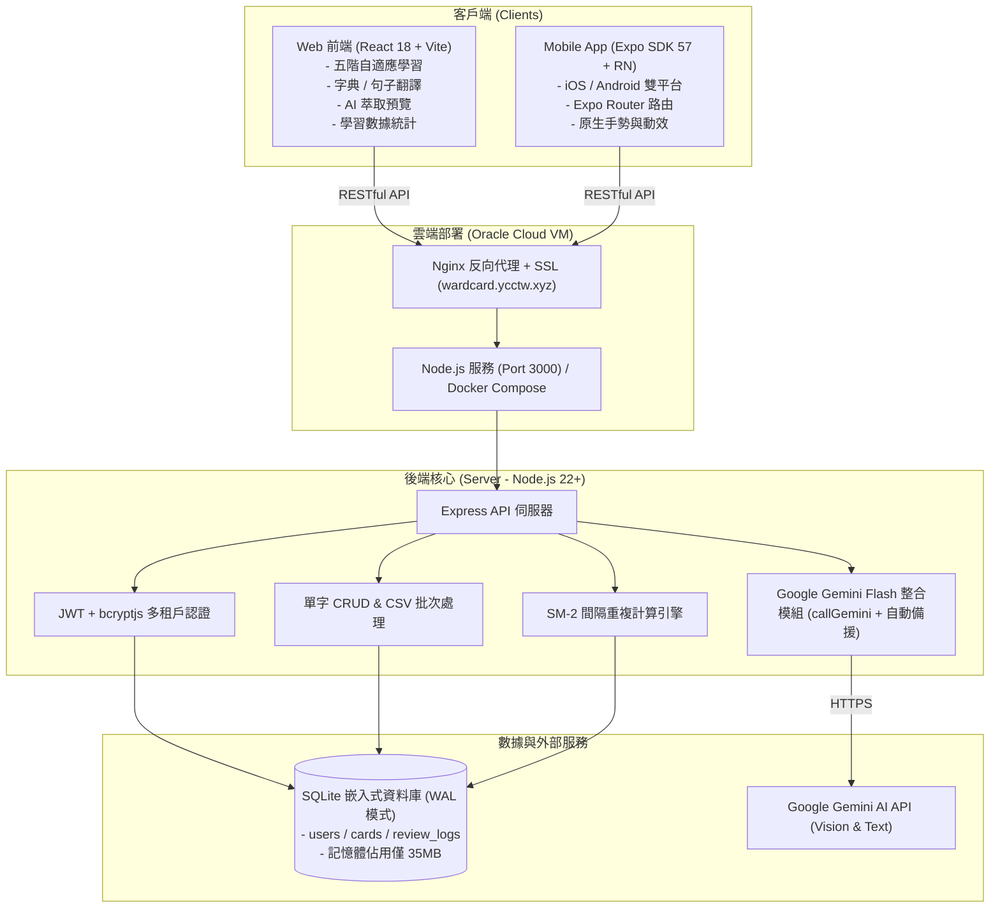

# 🇪🇸 PalabraCard 應用程式開發狀況總覽

> **最後更新時間**：2026-10-22  
> **專案版本**：v1.2.0 (FSRS v4.5 全面升級 / 五階自適應學習)  
> **專案代號**：PalabraCard (西語智慧單字卡 & FSRS 複習系統)  
> **GitHub 倉庫**：[CCHENYUCHI/WardCard](https://github.com/CCHENYUCHI/WardCard)  
> **線上服務網址**：`https://wardcard.ycctw.xyz`

---

## 1. 專案核心定位與目標

PalabraCard 是專為**西班牙語學習者**量身打造的跨平台智慧單字卡與記憶曲線複習應用程式。  
核心設計哲學：
1. **極致輕量化**：針對 Oracle Cloud Free Tier（1GB RAM 規格主機）設計，全後端運行記憶體僅佔用 **~35MB RAM**。
2. **AI 賦能學習**：整合 Google Gemini Flash（`gemini-3.6-flash`，備援 `gemini-3.5-flash-lite`），支援**課堂白板照片拍照 OCR** 或筆記純文字一鍵萃取結構化生詞卡。
3. **科學化記憶曲線**：實作現代 **FSRS (Free Spaced Repetition Scheduler) v4.5 動態遺忘曲線演算法**，支援目標記憶留存率與雙軌 SM-2 平滑遷移。
4. **專屬西語體驗**：支援冠詞 (el/la)、陰陽性、虛擬西語重音鍵盤（á, é, í, ó, ú, ü, ñ, ¿, ¡）、課本課次主修連動。

---

## 2. 系統架構總覽



---

## 3. 各端模組開發狀況與完成度

### 3.1 後端伺服器 (Server - Node.js + SQLite) —— 【完成度：97%】

後端程式碼位於 `server/`，採用 Node.js 22+ 內建原生 `node:sqlite`（`DatabaseSync`），不需龐大資料庫進程即可實現 ACID 與 WAL 高效並發。

| 功能模組 | 實作檔案 | 狀態 | 功能細節說明 |
| :--- | :--- | :---: | :--- |
| **多租戶身分驗證** | `server/index.js` | ✅ 已完成 | JWT 簽發/驗證 (7天效期)、bcrypt 密碼雜湊，提供 `/api/auth/register`, `/api/auth/login`, `/api/auth/me` |
| **資料庫架構與初始化** | `server/db.js` | ✅ 已完成 | 包含 `users`, `cards`, `review_logs` 資料表；WAL 模式加速；自動動態執行平滑遷移 (Migration) 擴充 FSRS 與生命週期狀態欄位 |
| **FSRS v4.5 記憶排程核心** | `server/fsrs.js` | ✅ 已完成 | 純 JS 實作 DSR (難度、穩定度、留存率) 模型，依使用者目標留存率動態預測遺忘週期與五階進化梯狀態變遷 |
| **今日行動學習駕駛艙 API** | `server/index.js` | ✅ 已完成 | `/api/study/agenda`，主動排程「🚨 緊急搶救 + 📚 例行穩固 + 🌱 課本主修新詞」，回傳單元掌握率與階層統計 |
| **每日任務 / 學習紀錄 API** | `server/dailyProgress.js`<br/>`server/time.js` | ✅ 已完成 | `/api/study/today`（今日目標、已完成、剩餘、加練、正確率、連續天數）、`/api/study/history`（近 N 天每日紀錄）、`/api/study/practice`（加練弱點單字）；每次複習標記 `task_type`；「今天」= `TZ` 時區 00:00～24:00 |
| **單字狀態流轉與批量激活 API** | `server/index.js` | ✅ 已完成 | `/api/cards/:id/status` (切換 Inbox/Ready/Active/星號) 與 `/api/study/activate-batch` (批量從單元待學庫提拔) |
| **單元掌握度統計 API** | `server/index.js` | ✅ 已完成 | `/api/study/units`，聚合各課本單元的詞彙總量、各階段人數與精通率 (Stage 3+) |
| **單字庫管理 API** | `server/index.js` | ✅ 已完成 | 支援 GET (多條件搜尋、分類、DELE、生命週期狀態、星號篩選)、POST (單筆/批次)、PUT (編輯)、DELETE |
| **FSRS / SM-2 雙模複習 API** | `server/index.js` | ✅ 已完成 | `/api/cards/:id/review`，接收 1~4 級打分與當前測驗階段，由 FSRS 計算更新下次到期日並向下相容舊版欄位 |
| **CSV 批次匯入** | `server/index.js` | ✅ 已完成 | `/api/cards/upload-csv`，使用 `csv-parse` 解析多種自訂欄位 (西語、中文、例句、性別等) |
| **學習進度統計 API** | `server/index.js`<br/>`server/dailyProgress.js` | ✅ 已完成 | `/api/stats`，回傳總卡片數、生命週期 / 五階分佈、DELE 等級與單元分佈；今日數字 (`due`、`today`) 與 7 天預報 (`getWeeklyForecast`：排定複習 + FSRS 預估複習 + 新詞配額) 與今日任務共用同一份計畫與主修單元範圍 |
| **AI 智慧萃取 API** | `server/ai.js` | ✅ 已完成 | 支援文字與照片上傳，`callGemini()` 以 responseSchema 結構化輸出西語單字、冠詞、詞性、繁中釋義、例句與文法筆記；只回傳預覽（含 `exists` 標記），不直接寫入資料庫；模型可用 `GEMINI_MODEL` / `GEMINI_FALLBACK_MODEL` 設定 |
| **西語語音代理 API** | `server/index.js` | ✅ 已完成 | `/api/tts`，Node 22 原生 fetch 串流西語音訊 (Cache-Control 24h 快取)，完美相容行動裝置與 Safari |
| **字典查詞 / 例句點字 API** | `server/dictionary.js`<br/>`server/index.js` | ✅ 已完成 | `GET /api/dictionary/lookup?q=&sentence=`（離線 Wiktionary + 我的單字庫 + AI 快取，不呼叫 AI）、`POST /api/dictionary/add`（加入暫存箱，不動既有卡）；查詢時依 `source=dictionary|tap` 寫入查詢紀錄 |
| **單字查詢紀錄 API** | `server/lookupHistory.js`<br/>`server/index.js` | ✅ 已完成 | `GET /api/dictionary/history?q=&sort=recent\|count&offset=`（每個字一筆、查詢次數、每頁 30 筆，附單字庫狀態）、`DELETE /api/dictionary/history/:id`、`DELETE /api/dictionary/history`（清除全部）；`POST /api/dictionary/ai` 查到中文時補進紀錄 |
| **AI 整句解析 / AI 字典詞條** | `server/ai.js`<br/>`server/index.js` | ✅ 已完成 | `POST /api/sentences/analyze`（`analyzeSentence`，逐字原形 / 意思 / 用法）、`POST /api/dictionary/ai`（`lookupWordAi`，沿用 `CARD_SCHEMA`）；皆用 flash-lite，結果存入共用快取表 |
| **句子翻譯與講解 API** | `server/ai.js`<br/>`server/translations.js`<br/>`server/index.js` | ✅ 已完成 | `POST /api/translations`（`translateSentence` + `normalizeTranslation`，flash-lite；先查自己的紀錄、再沿用任何人查過的同一句，都沒有才呼叫 AI）、`GET /api/translations?q=&offset=`（每頁 30 筆、搜尋原句 / 中文）、`DELETE /api/translations/:id` |
| **離線西英字典** | `server/scripts/build-dictionary.js` | ✅ 已完成 | `npm run build:dict -- <kaikki Spanish JSONL>` 串流建置 `data/dict/es-en.sqlite`（約 90MB，約 80 萬筆，含變化形 → 原形）；唯讀開啟、2MB page cache，執行時約多 1MB RAM；檔案不存在時自動略過 |

---

### 3.2 Web 前端 (Client - React + Vite) —— 【完成度：99%】

前端程式碼位於 `client/`，採用全新設計之 **Google Classroom / Material Design 3 乾淨教育美學風格**（米灰護眼底色 `#f8f9fa`、純白卡片 `#ffffff`、Google 經典藍 `#1a73e8`），全面告別高視覺負擔之深色霓虹，專注於高效高對比的語言學習體驗。

| 模組名稱 | 實作組件 | 狀態 | 特色與交互亮點 |
| :--- | :--- | :---: | :--- |
| **今日學習駕駛艙** | `DailyAgendaCockpit.jsx` | ✅ 已完成 | 核心入口！包含今日任務柱狀統計（緊急搶救/例行複習/新詞解鎖）、主修課本單元掌握度進度條、一鍵開始學習 CTA 與暫存箱徽章 |
| **今日任務卡 / 學習紀錄** | `TodayProgressCard.jsx`<br/>`StudyHistory.jsx`<br/>`ProgressRing.jsx` | ✅ 已完成 | 駕駛艙頂部：進度圓環、到期複習 / 新單字 / 加練拆分、🔥 連續天數、7 天週進度、加練一輪；下方近 30 天學習紀錄 |
| **自適應五階學習流** | `AdaptiveStudySession.jsx` | ✅ 已完成 | 依單字階級自動派發題型：S1 被動辨認 ➔ S2 主動回想 (首字母提示) ➔ S3 盲測正字拼寫 ➔ S4 語境克漏字（無例句時改拼字）➔ S5 語境四選一（干擾選項取自自己的單字庫），支援全套鍵盤快捷鍵（Enter 送出、1–4 選答 / 評分）與晉級反饋；西語比對工具集中於 `utils/spanish.js` |
| **身分驗證** | `LoginScreen.jsx` | ✅ 已完成 | 登入/註冊切換、JWT 本地存儲、自動轉導 |
| **導覽列與響應式** | `Navbar.jsx`<br/>`index.css` | ✅ 已完成 | 支援桌面/行動雙軌切換：桌面顯示 Google Classroom 完整頂部選單；手機版（< 768px）自動啟用高質感 iOS 毛玻璃底部導覽列 (Bottom Navigation Bar) 與精簡頂部 Bar，深度適配 Safe Area (`viewport-fit=cover`)；四邊 Safe Area 以 `--safe-*` CSS 變數統一管理，學習模式 (`is-immersive`) 自動讓出瀏海，彈窗於手機改為 Bottom Sheet |
| **單字庫管理** | `WordList.jsx`<br/>`WordModal.jsx` | ✅ 已完成 | 頂部狀態膠囊標籤（全部/活躍/待學/暫存/精通/星號）、單字卡一鍵打星 ⭐️ 與快捷激活、單元分類與階級徽章 |
| **AI 拍照/筆記萃取** | `AiImporter.jsx` | ✅ 已完成 | 支援拖曳上傳照片或直接貼上課堂筆記、Gemini 模型解析進度條、結構化表格預覽勾選、一鍵批次匯入單字庫 |
| **學習統計儀表板** | `StatsView.jsx` | ✅ 已完成 | 詞庫 / 活躍 / 今日到期 / 精通 / 待學 / 今日任務完成計數卡片、7 天週預報（排定 / 預估 / 新詞三色長條）、五階記憶梯、單元掌握度排行；切到分頁時重新抓取 |
| **字典查詞** | `DictionaryView.jsx`<br/>`WordLookupPanel.jsx`<br/>`LookupHistory.jsx` | ✅ 已完成 | 查西語（含變化形）或中文；顯示我的單字、AI 詞條、Wiktionary 英文釋義、外部字典連結；「用 AI 查中文」與「加入單字庫」；各西語字旁 🔊 發音（`SpeakButton.jsx`，搜尋時不自動念）；下方「查詢紀錄」（查詞與點字都記，每個字一筆、次數、最近 / 最常查排序、搜尋、再查、刪除 / 清除）。Navbar 桌面「查詞」分頁、手機底部列 |
| **句子翻譯與講解** | `TranslatorView.jsx`<br/>`TranslationResult.jsx` | ✅ 已完成 | 輸入句子（Enter 送出、重音鍵）→ 中英翻譯、修正提示、依類型上色的重點卡片與補充例句、其他說法；句子可點字查詢與朗讀；翻譯紀錄可搜尋、展開、刪除。Navbar「翻譯」分頁（手機底部列） |
| **例句點字查詢** | `TappableSentence.jsx`<br/>`utils/dictionary.js` | ✅ 已完成 | 自適應學習五階段的例句皆可點字；桌面小視窗 / 手機 Bottom Sheet；挖空答案不可點、點字不翻卡、視窗開啟時攔截 Space / 1–4；「✨ AI 解析這句」；點字自動念出該字（手勢內同步播放，iOS 可用），連點不排隊 |
| **個人設定** | `SettingsModal.jsx` | ✅ 已完成 | 支援自訂 Gemini API Key、AI 一鍵校準 DELE 級數、FSRS 每日新詞配額 (10~50字) 與留存率目標 (85%~95%)、雙引擎發音切換、JSON/CSV 備份與還原 |

---

### 3.3 行動端應用 (Mobile - React Native + Expo) —— 【完成度：80%】

行動端程式碼位於 `mobile/`，採用最新 Expo SDK 57、React 19 與 Expo Router 架構，專為 iOS 與 Android 手機操作優化。

| 畫面 / 路由 | 實作檔案 | 狀態 | 實作進度說明 |
| :--- | :--- | :---: | :--- |
| **入口登入頁** | `src/app/index.tsx` | ✅ 已完成 | 登入與註冊切換、AsyncStorage 存儲 Token、鍵盤自適應防遮擋 |
| **主頁儀表板** | `src/app/home.tsx` | ✅ 已完成 | 統計卡片（待複習/已學/精通）、拼字測驗入口、翻轉字卡入口、單字庫捷徑 |
| **單字庫瀏覽** | `src/app/words.tsx` | ✅ 已完成 | FlatList 列表渲染、Picker 分類篩選、關鍵字搜尋、新增與編輯 Modal |
| **3D 翻轉字卡** | `src/app/flashcard.tsx` | ✅ 已完成 | React Native Animated 3D 翻轉動畫、SM-2 四階打分送出 |
| **拼字測驗畫面** | `src/app/review.tsx` | ✅ 已完成 | 西語特殊重音符號軟鍵盤、例句挖空提示、性別縮寫容錯比對 |
| **AI 智慧萃取** | `src/app/ai.tsx` | ✅ 已完成 | 文字貼上或拍照 / 相簿萃取單字、結果勾選預覽、只儲存勾選的單字；帶使用者自己的 Gemini Key |
| **設定頁面** | `src/app/settings.tsx` | ✅ 已完成 | 顯示使用者資訊、Gemini API Key 設定、安全登出、Expo DocumentPicker CSV 檔案上傳匯入 |
| **全域環境變數整合** | `src/constants/api.ts` | 🚧 需優化 | `API_URL` 已統一到一個常數檔；之後可再改為 `app.config.js` / `.env` 配置以切換環境 |
| **原生相機拍照萃取** | `src/app/ai.tsx` | ✅ 已完成 | `expo-image-picker` 拍照 / 相簿（quality 0.6），需要相機與相簿權限（已設定於 `app.json`） |

---

### 3.4 部署與維運 (DevOps / Docker) —— 【完成度：85%】

| 項目 | 檔案 | 狀態 | 說明 |
| :--- | :--- | :---: | :--- |
| **Docker 容器化** | `Dockerfile` | 🚧 調整中 | 正由多階段構建調整為直接載入預編譯前端，降低記憶體消耗 |
| **Docker Compose** | `docker-compose.yml` | 🚧 調整中 | 配置 Port 3000、持久化資料卷 `./data:/app/data`、健康檢查 |
| **PM2 原生運行** | 說明於 `README.md` | ✅ 已驗證 | 適合 Oracle Cloud 免裝 Docker 直接常駐，實測 ~32MB RAM |
| **CI/CD 自動化** | `.github/workflows/` | 📅 規劃中 | 待建立 GitHub Actions 自動跑 Lint、TypeScript 檢查與 Docker 自動建置 |

---

## 4. 資料庫綱要 (Database Schema)

資料庫採用原生 SQLite，預設路徑 `./data/wordcard.db`。

```sql
-- 使用者帳號表
CREATE TABLE IF NOT EXISTS users (
  id INTEGER PRIMARY KEY AUTOINCREMENT,
  username TEXT UNIQUE NOT NULL,
  password_hash TEXT NOT NULL,
  created_at TEXT DEFAULT (datetime('now', 'localtime'))
);

-- 單字卡片表
CREATE TABLE IF NOT EXISTS cards (
  id INTEGER PRIMARY KEY AUTOINCREMENT,
  user_id INTEGER DEFAULT 1,
  word TEXT NOT NULL,
  article TEXT DEFAULT '',          -- 冠詞: el, la, los, las 等
  gender TEXT DEFAULT 'none',       -- 陰陽性: masculino, femenino, none
  part_of_speech TEXT DEFAULT 'sustantivo', -- 詞性
  translation TEXT NOT NULL,        -- 繁體中文釋義
  english_translation TEXT DEFAULT '',
  definition_es TEXT DEFAULT '',     -- 西語原文釋義
  example_es TEXT DEFAULT '',        -- 西語例句
  example_zh TEXT DEFAULT '',        -- 例句中文翻譯
  notes TEXT DEFAULT '',             -- 常用文法規則/動詞變化筆記
  category TEXT DEFAULT '日常生活',  -- 分類
  dele_level TEXT DEFAULT 'A2',      -- DELE 等級 (A1, A2, B1, B2, C1, C2)
  repetition INTEGER DEFAULT 0,     -- SM-2 複習連續正確次數
  interval_days INTEGER DEFAULT 0,  -- SM-2 當前間隔天數
  ease_factor REAL DEFAULT 2.5,     -- SM-2 難度因子 (預設 2.5)
  due_date TEXT DEFAULT (datetime('now', 'localtime')), -- 到期需複習時間
  last_reviewed TEXT DEFAULT NULL,  -- 最後複習時間
  review_count INTEGER DEFAULT 0,   -- 總複習次數
  lapse_count INTEGER DEFAULT 0,    -- 遺忘/答錯次數
  -- 【v1.2.0 FSRS & 主動學習升級欄位】
  lifecycle_status TEXT DEFAULT 'active', -- 狀態: 'inbox'(暫存), 'ready'(待學), 'active'(活躍), 'mastered'(精通), 'frozen'(凍結)
  is_starred INTEGER DEFAULT 0,           -- ⭐️ 核心重要詞 (1: 是, 0: 否)
  mastery_stage INTEGER DEFAULT 1,        -- 五階進化狀態機 (Stage 1~5)
  fsrs_stability REAL DEFAULT 0.0,        -- FSRS 記憶穩定度 (Stability，單位：天)
  fsrs_difficulty REAL DEFAULT 5.0,       -- FSRS 客觀單字難度 (1.0~10.0)
  fsrs_reps INTEGER DEFAULT 0,            -- FSRS 連續回想成功次數
  curriculum_unit TEXT DEFAULT '',        -- 課本進度單元標籤 (如: Capítulo 1)
  created_at TEXT DEFAULT (datetime('now', 'localtime')),
  updated_at TEXT DEFAULT (datetime('now', 'localtime'))
);

-- 複習歷史紀錄表
CREATE TABLE IF NOT EXISTS review_logs (
  id INTEGER PRIMARY KEY AUTOINCREMENT,
  user_id INTEGER DEFAULT 1,
  card_id INTEGER NOT NULL,
  rating INTEGER NOT NULL,          -- 1(忘記), 2(困難), 3(良好), 4(容易)
  review_mode TEXT NOT NULL,        -- 'flashcard' 或 'spelling'
  task_type TEXT DEFAULT NULL,      -- 'due'(今日到期複習) / 'new'(第一次學) / 'extra'(加練)；NULL 視為 'due'
  reviewed_at TEXT DEFAULT (datetime('now', 'localtime')),
  FOREIGN KEY(card_id) REFERENCES cards(id) ON DELETE CASCADE
);
CREATE INDEX IF NOT EXISTS idx_review_logs_user_time ON review_logs(user_id, reviewed_at);

-- 每日任務快照（歷史紀錄用來判斷當天是否達標）
CREATE TABLE IF NOT EXISTS daily_progress (
  user_id INTEGER NOT NULL,
  day TEXT NOT NULL,                -- 本地日期 'YYYY-MM-DD'
  goal INTEGER DEFAULT 0,           -- 今日任務量 (已完成 + 剩餘)
  done INTEGER DEFAULT 0,           -- 已完成任務 (due + new)
  extra INTEGER DEFAULT 0,          -- 加練次數
  updated_at TEXT DEFAULT (datetime('now', 'localtime')),
  PRIMARY KEY (user_id, day)
);
-- 時間一律以本地時間字串儲存；時區由 TZ 環境變數決定（預設 Asia/Taipei）

-- AI 查詞快取（所有使用者共用，不綁卡片，刪卡不需清理）
CREATE TABLE IF NOT EXISTS sentence_analyses (
  sentence_hash TEXT PRIMARY KEY,   -- sha1(空白正規化後的句子)
  sentence TEXT NOT NULL,
  result TEXT NOT NULL,             -- JSON { translation_zh, tokens: [{ text, lemma, pos, zh, usage }] }
  model TEXT,
  created_at TEXT DEFAULT (datetime('now', 'localtime'))
);
CREATE TABLE IF NOT EXISTS dictionary_cache (
  query_norm TEXT PRIMARY KEY,      -- 小寫、去重音後的查詢字（變化形與原形各存一筆）
  result TEXT NOT NULL,             -- JSON 卡片（normalizeAiCard 格式）
  model TEXT,
  created_at TEXT DEFAULT (datetime('now', 'localtime'))
);

-- 句子翻譯紀錄（每位使用者自己的，不綁卡片，刪卡不需清理）
CREATE TABLE IF NOT EXISTS translations (
  id INTEGER PRIMARY KEY AUTOINCREMENT,
  user_id INTEGER NOT NULL,
  input_text TEXT NOT NULL,          -- 使用者輸入的原文
  input_hash TEXT NOT NULL,          -- sha1(小寫 + 空白正規化)；也用來跨使用者沿用同一句的結果
  source_lang TEXT DEFAULT 'es',     -- 'es' | 'zh'
  translation_zh TEXT DEFAULT '',    -- 列表與搜尋用
  result TEXT NOT NULL,              -- JSON { source_lang, spanish, correction, translation_zh, translation_en, points: [{ type, title, explanation, examples: [{ es, zh }] }], alternatives: [{ es, zh, note }] }
  model TEXT,
  created_at TEXT DEFAULT (datetime('now', 'localtime')),
  UNIQUE(user_id, input_hash)
);
CREATE INDEX IF NOT EXISTS idx_translations_hash ON translations(input_hash);
CREATE INDEX IF NOT EXISTS idx_translations_user_time ON translations(user_id, created_at);

-- 單字查詢紀錄（查詞頁 + 例句點字；每位使用者每個字一筆，不綁卡片，刪卡不需清理）
CREATE TABLE IF NOT EXISTS lookup_history (
  id INTEGER PRIMARY KEY AUTOINCREMENT,
  user_id INTEGER NOT NULL,
  query TEXT NOT NULL,                     -- 最近一次查的寫法
  query_norm TEXT NOT NULL,                -- normalizeWord(query)：小寫、去重音
  lemma TEXT DEFAULT '',                   -- 查到的原形（fui → ir）
  translation TEXT DEFAULT '',             -- 查到的中文；空的時候由 AI 查詞補上，列表另以卡片中文補位
  lookup_count INTEGER DEFAULT 1,
  last_source TEXT DEFAULT 'dictionary',   -- 'dictionary'(查詞頁) | 'tap'(例句點字)
  first_at TEXT DEFAULT (datetime('now', 'localtime')),
  last_at TEXT DEFAULT (datetime('now', 'localtime')),
  UNIQUE(user_id, query_norm)
);
CREATE INDEX IF NOT EXISTS idx_lookup_history_user_time ON lookup_history(user_id, last_at);
```

離線字典是**獨立的唯讀 SQLite 檔** `data/dict/es-en.sqlite`（`DICT_DB_PATH`），由 `build-dictionary.js` 產生：

```sql
CREATE TABLE entries (
  word TEXT NOT NULL,
  word_norm TEXT NOT NULL,   -- 小寫、去重音（索引）
  pos TEXT,                  -- wiktextract 詞性：noun, verb, adj, ...
  gender TEXT,               -- 'm' | 'f' | 'mf' | ''
  glosses TEXT,              -- JSON string[]（英文釋義，最多 4 個）
  form_of TEXT               -- JSON [{ lemma, via }]：變化形 → 原形與文法說明
);
```

---

## 5. 目前工作區未提交變更與待處置清單

截至目前工作目錄的 Git 狀態：
1. **已修改檔案 (Modified)**：
   - `Dockerfile` & `docker-compose.yml`：優化容器配置與健康檢查。
   - `client/src/App.jsx` & `client/src/components/Navbar.jsx`：接入字典 Tab 入口。
   - `server/index.js`：分類 API 取值微調。
2. **未追蹤檔案 (Untracked)**：
   - `client/src/components/DictionaryView.jsx`：字典視圖組件原型。
   - `mobile/`：完整 Expo 行動端專案代碼庫。
   - `dist.tar.gz`、`wordcard.tar.gz`：臨時壓縮封裝檔（需確認是否加入 `.gitignore`）。

這些未提交項目的管理規範詳見：[GIT與GITHUB管理規範.md](./GIT與GITHUB管理規範.md)。
