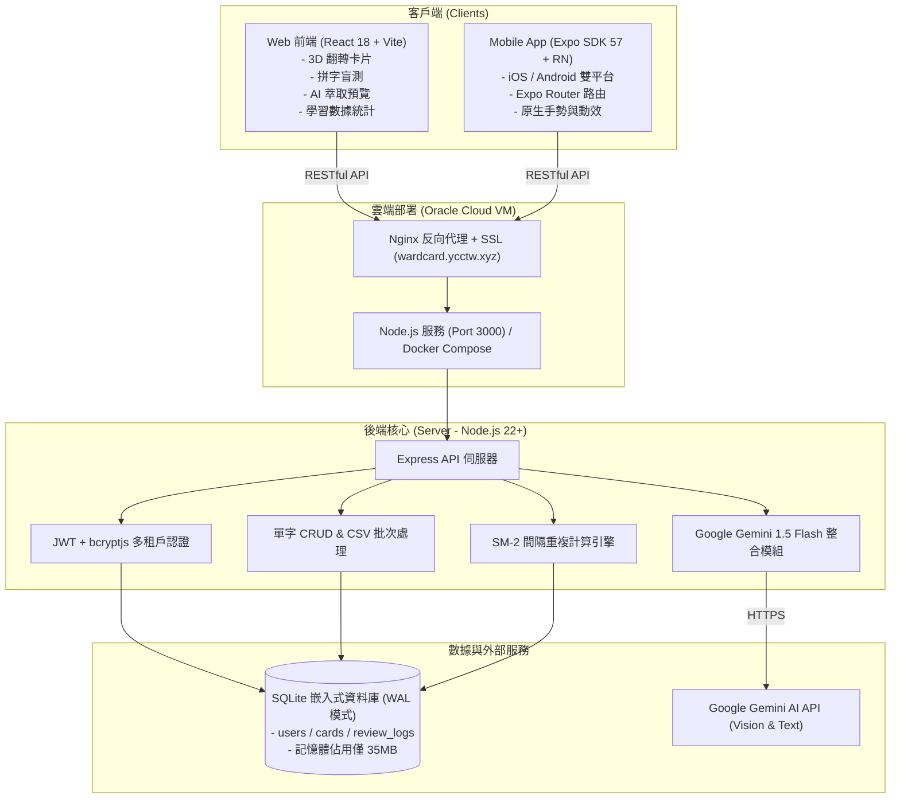

# 🇪🇸 PalabraCard 應用程式開發狀況總覽

> **最後更新時間**：2026-10-09  
> **專案版本**：v1.1.0 (Web 生產運行中 / Mobile Beta 階段)  
> **專案代號**：PalabraCard (西語智慧單字卡 & SRS 複習系統)  
> **GitHub 倉庫**：[CCHENYUCHI/WardCard](https://github.com/CCHENYUCHI/WardCard)  
> **線上服務網址**：`https://wardcard.ycctw.xyz`

---

## 1. 專案核心定位與目標

PalabraCard 是專為**西班牙語學習者**量身打造的跨平台智慧單字卡與記憶曲線複習應用程式。  
核心設計哲學：
1. **極致輕量化**：針對 Oracle Cloud Free Tier（1GB RAM 規格主機）設計，全後端運行記憶體僅佔用 **~35MB RAM**。
2. **AI 賦能學習**：整合 Google Gemini 1.5 Flash，支援**課堂白板照片拍照 OCR** 或筆記純文字一鍵萃取結構化生詞卡。
3. **科學化記憶曲線**：實作經典 **SM-2 (SuperMemo-2) 間隔重複演算法**，抗遺忘週期化訓練。
4. **專屬西語體驗**：支援冠詞 (el/la)、陰陽性、虛擬西語重音鍵盤（á, é, í, ó, ú, ü, ñ, ¿, ¡）、DELE 等級標籤 (A1~C2)。

---

## 2. 系統架構總覽



---

## 3. 各端模組開發狀況與完成度

### 3.1 後端伺服器 (Server - Node.js + SQLite) —— 【完成度：90%】

後端程式碼位於 `server/`，採用 Node.js 22+ 內建原生 `node:sqlite`（`DatabaseSync`），不需龐大資料庫進程即可實現 ACID 與 WAL 高效並發。

| 功能模組 | 實作檔案 | 狀態 | 功能細節說明 |
| :--- | :--- | :---: | :--- |
| **多租戶身分驗證** | `server/index.js` | ✅ 已完成 | JWT 簽發/驗證 (7天效期)、bcrypt 密碼雜湊，提供 `/api/auth/register`, `/api/auth/login`, `/api/auth/me` |
| **資料庫架構與初始化** | `server/db.js` | ✅ 已完成 | 包含 `users`, `cards`, `review_logs` 資料表；WAL 模式加速；內建精選西語種子單字 (`desarrollar`, `problema`, `costumbre`) |
| **單字庫管理 API** | `server/index.js` | ✅ 已完成 | 支援 GET (多條件搜尋、分類、DELE、複習狀態篩選)、POST (單筆/批次)、PUT (編輯)、DELETE |
| **SM-2 複習演算法** | `server/index.js` | ✅ 已完成 | `/api/cards/:id/review`，根據 1~4 級評分計算下次複習日期 (`due_date`)、`interval_days`、`ease_factor` (最低1.3) 與 `lapse_count` |
| **複習隊列 API** | `server/index.js` | ✅ 已完成 | `/api/cards/due`，取得當前已到期需複習的單字卡，支援分類篩選 |
| **CSV 批次匯入** | `server/index.js` | ✅ 已完成 | `/api/cards/upload-csv`，使用 `csv-parse` 解析多種自訂欄位 (西語、中文、例句、性別等) |
| **學習進度統計 API** | `server/index.js` | ✅ 已完成 | `/api/stats`，回傳總卡片數、待複習、已學習、已精通、今日複習次數、DELE 等級分佈與分類分佈 |
| **AI 智慧萃取 API** | `server/ai.js` | ✅ 已完成 | 支援文字與照片上傳，呼叫 Gemini 1.5 Flash 結構化輸出西語單字、冠詞、詞性、繁中釋義、例句與文法筆記 |
| **AI 字典即時查詞 API** | `server/index.js` | 🚧 進行中 | 預計提供 `/api/dictionary/lookup` 單字即時查詢與一鍵入庫功能 |

---

### 3.2 Web 前端 (Client - React + Vite) —— 【完成度：95%】

前端程式碼位於 `client/`，採用精緻的 Dark Glassmorphism（深色玻璃擬態）現代化視覺風格，並自研動效與快捷鍵支援。

| 模組名稱 | 實作組件 | 狀態 | 特色與交互亮點 |
| :--- | :--- | :---: | :--- |
| **身分驗證** | `LoginScreen.jsx` | ✅ 已完成 | 登入/註冊切換、JWT 本地存儲、自動轉導 |
| **導覽列** | `Navbar.jsx` | ✅ 已完成 | 包含待複習 Badge 徽章、登出、快速新增、設定彈窗捷徑 |
| **單字庫管理** | `WordList.jsx`<br/>`WordModal.jsx` | ✅ 已完成 | 支援即時搜尋 (單字/翻譯/筆記)、分類與 DELE (A1~C2) 標籤篩選、待複習/已學狀態篩選、單字卡完整編輯/刪除彈窗 |
| **3D 翻轉卡片模式** | `FlashcardReview.jsx` | ✅ 已完成 | 支援 CSS 3D 透視翻轉、鍵盤快捷鍵 (`Space` 翻轉、`1/2/3/4` 評分)、Web Speech API 真人語音朗讀、慶祝彩帶動效 (`canvas-confetti`) |
| **拼字盲測模式** | `SpellingReview.jsx` | ✅ 已完成 | 內建西語特殊符號虛擬鍵盤、例句挖空提示、智慧防呆比對（支援冠詞忽略、性別斜線 `o/a` 解析） |
| **AI 拍照/筆記萃取** | `AiImporter.jsx` | ✅ 已完成 | 支援拖曳上傳照片或直接貼上課堂筆記、Gemini 模型解析進度條、結構化表格預覽勾選、一鍵批次匯入單字庫 |
| **學習統計儀表板** | `StatsView.jsx` | ✅ 已完成 | 待複習/已學習/已精通計數卡片、今日進度圓環、DELE 等級長條圖分佈、類別掌握分佈 |
| **AI 智慧字典** | `DictionaryView.jsx` | 🚧 進行中 | 目前已建置入口與 UI 原型，等待後端查詞 API 與入庫對接 |
| **個人設定** | `SettingsModal.jsx` | ✅ 已完成 | 支援自訂使用者個人 Gemini API Key、模型選擇、清除憑證 |

---

### 3.3 行動端應用 (Mobile - React Native + Expo) —— 【完成度：80%】

行動端程式碼位於 `mobile/`，採用最新 Expo SDK 57、React 19 與 Expo Router 架構，專為 iOS 與 Android 手機操作優化。

| 畫面 / 路由 | 實作檔案 | 狀態 | 實作進度說明 |
| :--- | :--- | :---: | :--- |
| **入口登入頁** | `src/app/index.tsx` | ✅ 已完成 | 登入與註冊切換、AsyncStorage 存儲 Token、鍵盤自適應防遮擋 |
| **主頁儀表板** | `src/app/home.tsx` | ✅ 已完成 | 統計卡片（待複習/已學/精通）、拼字測驗入口、翻轉字卡入口、單字庫捷徑 |
| **單字庫瀏覽** | `src/app/words.tsx` | ✅ 已完成 | FlatList 列表渲染、Picker 分類篩選、關鍵字搜尋、新增與編輯 Modal |
| **3D 翻轉字卡** | `src/app/flashcard.tsx` | ✅ 已完成 | React Native Animated 3D 翻轉動畫、SM-2 四階打分送出 |
| **拼字測驗畫面** | `src/app/review.tsx` | ✅ 已完成 | 西語特殊重音符號軟鍵盤、例句挖空提示、性別縮寫容錯比對 |
| **AI 智慧萃取** | `src/app/ai.tsx` | ✅ 已完成 | 文字貼上萃取單字、結果預覽與一鍵批量儲存至雲端資料庫 |
| **設定頁面** | `src/app/settings.tsx` | ✅ 已完成 | 顯示使用者資訊、安全登出、Expo DocumentPicker CSV 檔案上傳匯入 |
| **全域環境變數整合** | 多個檔案 | 🚧 需優化 | 目前 `API_URL` 硬編碼為 `https://wardcard.ycctw.xyz/api`，應抽出為 `app.config.js` / `.env` 配置 |
| **原生相機拍照萃取** | `src/app/ai.tsx` | 📅 規劃中 | 預計整合 `expo-image-picker` 實現手機鏡頭直接拍白板上傳 |

---

### 3.4 部署與維運 (DevOps / Docker) —— 【完成度：85%】

| 項目 | 檔案 | 狀態 | 說明 |
| :--- | :--- | :---: | :--- |
| **Docker 容器化** | `Dockerfile` | 🚧 調整中 | 正由多階段構建調整為直接載入預編譯前端，降低記憶體消耗 |
| **Docker Compose** | `docker-compose.yml` | 🚧 調整中 | 配置 Port 3000、持久化資料卷 `./data:/app/data`、健康檢查 |
| **PM2 原生運行** | 說明於 `README.md` | ✅ 已驗證 | 適合 Oracle Cloud 免裝 Docker 直接常駐，實測 ~32MB RAM |
| **CI/CD 自動化** | `.github/workflows/` | 📅 規劃中 | 待建立 GitHub Actions 自動跑 Lint、TypeScript 檢查與 Docker 自動建置 |

---

## 4. 資料庫綱要 (Database Schema)

資料庫採用原生 SQLite，預設路徑 `./data/wordcard.db`。

```sql
-- 使用者帳號表
CREATE TABLE IF NOT EXISTS users (
  id INTEGER PRIMARY KEY AUTOINCREMENT,
  username TEXT UNIQUE NOT NULL,
  password_hash TEXT NOT NULL,
  created_at TEXT DEFAULT (datetime('now', 'localtime'))
);

-- 單字卡片表
CREATE TABLE IF NOT EXISTS cards (
  id INTEGER PRIMARY KEY AUTOINCREMENT,
  user_id INTEGER DEFAULT 1,
  word TEXT NOT NULL,
  article TEXT DEFAULT '',          -- 冠詞: el, la, los, las 等
  gender TEXT DEFAULT 'none',       -- 陰陽性: masculino, femenino, none
  part_of_speech TEXT DEFAULT 'sustantivo', -- 詞性
  translation TEXT NOT NULL,        -- 繁體中文釋義
  english_translation TEXT DEFAULT '',
  definition_es TEXT DEFAULT '',     -- 西語原文釋義
  example_es TEXT DEFAULT '',        -- 西語例句
  example_zh TEXT DEFAULT '',        -- 例句中文翻譯
  notes TEXT DEFAULT '',             -- 常用文法規則/動詞變化筆記
  category TEXT DEFAULT '日常生活',  -- 分類
  dele_level TEXT DEFAULT 'A2',      -- DELE 等級 (A1, A2, B1, B2, C1, C2)
  repetition INTEGER DEFAULT 0,     -- SM-2 複習連續正確次數
  interval_days INTEGER DEFAULT 0,  -- SM-2 當前間隔天數
  ease_factor REAL DEFAULT 2.5,     -- SM-2 難度因子 (預設 2.5)
  due_date TEXT DEFAULT (datetime('now', 'localtime')), -- 到期需複習時間
  last_reviewed TEXT DEFAULT NULL,  -- 最後複習時間
  review_count INTEGER DEFAULT 0,   -- 總複習次數
  lapse_count INTEGER DEFAULT 0,    -- 遺忘/答錯次數
  created_at TEXT DEFAULT (datetime('now', 'localtime')),
  updated_at TEXT DEFAULT (datetime('now', 'localtime'))
);

-- 複習歷史紀錄表
CREATE TABLE IF NOT EXISTS review_logs (
  id INTEGER PRIMARY KEY AUTOINCREMENT,
  user_id INTEGER DEFAULT 1,
  card_id INTEGER NOT NULL,
  rating INTEGER NOT NULL,          -- 1(忘記), 2(困難), 3(良好), 4(容易)
  review_mode TEXT NOT NULL,        -- 'flashcard' 或 'spelling'
  reviewed_at TEXT DEFAULT (datetime('now', 'localtime')),
  FOREIGN KEY(card_id) REFERENCES cards(id) ON DELETE CASCADE
);
```

---

## 5. 目前工作區未提交變更與待處置清單

截至目前工作目錄的 Git 狀態：
1. **已修改檔案 (Modified)**：
   - `Dockerfile` & `docker-compose.yml`：優化容器配置與健康檢查。
   - `client/src/App.jsx` & `client/src/components/Navbar.jsx`：接入字典 Tab 入口。
   - `server/index.js`：分類 API 取值微調。
2. **未追蹤檔案 (Untracked)**：
   - `client/src/components/DictionaryView.jsx`：字典視圖組件原型。
   - `mobile/`：完整 Expo 行動端專案代碼庫。
   - `dist.tar.gz`、`wordcard.tar.gz`：臨時壓縮封裝檔（需確認是否加入 `.gitignore`）。

這些未提交項目的管理規範詳見：[GIT與GITHUB管理規範.md](./GIT與GITHUB管理規範.md)。
